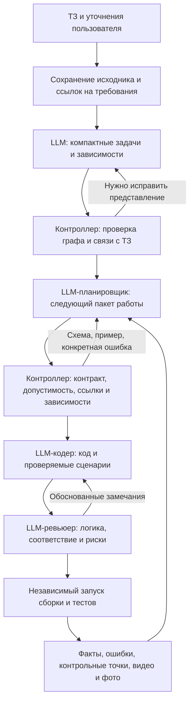

# Согласованная архитектура пайплайна разработки

**Статус внедрения:** [runtime v1](audit/SEMANTIC_PIPELINE_V1_RU.md).
Таблица раздела 10 ниже сохранена как снимок состояния до реализации.
Действующие строгие схемы находятся в `schemas/pipeline/`.

Наглядное объяснение с предлагаемыми точными форматами сообщений:
[интерактивная HTML-схема](docs/pipeline/index.html),
[JSON Schema и примеры](docs/pipeline/README_RU.md).
Контракты `proposal-v1` служат проектом реализации и не меняют действующий API.

Дата: 26.10.2026. Обобщение обсуждения, начавшегося с пересмотра полного пайплайна.

Это описание развития лаборатории, а не ТЗ конкретного мода. Оно не добавляет
модам новых требований и не означает, что все перечисленные механизмы уже
реализованы. Текущее состояние отделено от целевого в разделе 10.

## 1. Основные договорённости

1. ТЗ и явные уточнения пользователя определяют требования продукта. Планировщик,
   кодер и ревьюер не добавляют обязательных функций от себя.
2. Смысловое выделение задач, зависимости и выбор работы поручаются LLM.
   Программный контроллер проверяет данные, выполняет назначения и сохраняет состояние.
3. Число задач и объём пакета для кодера не фиксируются. Учитываются связность,
   сложность, зависимости, стоимость реализации и возможность проверки.
4. Разбиение не должно раздуваться. Создание файла, класса или метода обычно
   является шагом реализации, а не самостоятельной функциональной задачей.
5. Все рабочие решения и результаты сохраняются с происхождением и ссылками.
   Ограничение контекста агента не должно удалять постоянную память.
6. Повторения без новых данных требуют изменения подхода. Счётчик неудачных
   раундов сам по себе не должен останавливать разработку или сбрасывать проект.
7. Подтверждение результата принадлежит независимому проверяющему процессу.
   Уверенность кодера, ревьюера или планировщика не устанавливает PASS.
8. Изоляция, пользовательский бюджет, явная пауза и сохранность данных обязательны.
   Они не являются скрытыми требованиями к функциональности мода.

## 2. Общая последовательность

Обмен кодера и ревьюера должен приносить новые выводы. Повторение обсуждения
без новых оснований переводится в конкретный эксперимент либо передаётся
планировщику. Память пополняется на всех этапах, а не только после успеха.

## 3. Разбиение ТЗ и планирование

- Исходный Markdown сохраняется вместе с версиями и ссылками на фрагменты.
  Не нужно превращать каждый абзац, номер списка или пояснение в отдельную задачу.
- Планировщик выделяет компактные задачи с наблюдаемым результатом для пользователя.
  Указывает связанные требования, зависимости и способ проверки.
- Зависимости образуют направленный ациклический граф (DAG). Контроллер проверяет
  отсутствие циклов; ошибочный граф возвращается планировщику для исправления.
- Контроллер проверяет полноту связей, существование ID, корректность зависимостей
  и отсутствие потерянных требований. Формальная полнота связей сама по себе
  не доказывает смысловую полноту реализации.
- Смысловую обоснованность предложений оценивает LLM. Программная проверка
  контроллера относится к контракту, связям, состоянию и правилам допустимости.
- Перед каждым раундом пакет выбирается по текущим результатам, ошибкам,
  зависимостям и доступным возможностям. Порядок не фиксируется навсегда в начале проекта.
- Одна сложная задача может занять раунд; несколько связанных небольших задач
  могут выполняться вместе с общей проверкой.
- Можно объединять и разделять задачи, сохраняя историю и связь с исходным ТЗ.
  Переформулирование задачи не закрывает её требования.
- Переход к независимой функциональности не должен ограничиваться текущим
  разделом Markdown. При этом нельзя выбирать работу, реально зависящую от блокера.

## 4. Участники и использование LLM

| Участник | LLM | Ответственность |
| --- | --- | --- |
| Приём ТЗ и веб-панель | Нет | Сохранение файлов, настроек и команд пользователя |
| Выделение функциональных задач и зависимостей | Да, в целевой архитектуре | Осмысленная декомпозиция со связями с ТЗ |
| Планировщик | Да | Выбор пакета, гипотезы, стратегия исправления, рефлексия |
| Контроллер | Нет | Проверка контрактов и состояния, запуск этапов, бюджеты и изоляция |
| Кодер | Да | Реализация назначенной работы и сценариев; отчёт о сделанном и неизвестном |
| Ревьюер | Да | Независимое чтение кода, проверка логики, соответствия заданию и качества сценариев |
| Исполнитель сборки и игровых проверок | Нет | Фактическое выполнение, сбор результатов и артефактов |
| Запись видео и скриншотов | Нет | Фиксация выполненного игрового сценария |
| Память, индексирование и история | Нет | Сохранение, происхождение, подборка и выдача записей |
| Шлюз провайдеров и статистика расхода | Нет | Передача запросов моделям и учёт usage |

Рефлексия является режимом работы планировщика. Для неё не обязательно заводить
ещё одну LLM. Контроллер может обнаружить признаки повторения, но исследование
причин и выбор новой стратегии выполняет планировщик.

## 5. Контракты входа и выхода

Каждая граница модулей должна иметь версионированную схему, инструкцию,
валидные примеры и проверку совместимости. Все модели роли используют один
контракт; различия протоколов провайдеров обрабатываются адаптером.

| Контракт | Содержание |
| --- | --- |
| RequirementsCatalog | Источники требований, постоянные ID, версии ТЗ и ссылки на фрагменты |
| TaskGraph | Задачи, зависимости, связанные требования и критерии завершения |
| PlannerInput | Доступные задачи, текущая версия кода, наблюдения, ошибки, попытки и ссылки на память |
| PlannerDecision | Действия, порядок, причины выбора, гипотезы и требуемые проверки |
| CoderAssignment | Проверенное конкретное поручение и необходимые ограничения текущего проекта |
| CoderReport | Заявленные изменения, сценарии, незавершённые части, причины и ссылки |
| ReviewRequest | Назначение, связанные требования, версия и изменения кода, сценарии и диагностика |
| ReviewResult | Замечания с обоснованием, ссылками и способом проверки; рекомендации отдельно |
| VerificationResult | Реальная версия кода, выполненные проверки, наблюдения, результаты и доказательства |
| MemoryRecord | Исходная запись, происхождение, связи, версия и результат, назначенный контроллером |

Это названия целевых контрактов, а не перечень уже созданных файлов схем.
JSON используется для управления процессом. Исходники остаются файлами, логи —
текстом, видео — MP4. В сообщения передаются ссылки и метаданные, а не весь архив.

При ошибке формата система должна сообщить путь поля, ожидаемый тип, допустимые
значения или размер и дать подходящий пример. Например: requirement_ids — массив
строк, evidence_refs — массив объектов, необязательное поле можно опустить.
Если смысл плана уже понятен, не требуется заново исследовать проект ради формы.

После повторной ошибки меняется способ объяснения: нужный фрагмент схемы,
подходящий пример, разбор противоречия. Одинаковые короткие отказы и жёсткое
завершение после одной коррекции не соответствуют согласованному поведению.
Коррекции остаются в пользовательском бюджете; произвольный план не исполняется.
Нельзя угадывать смысл, автоматически переставляя поля или дорисовывая скобки.

## 6. Совместная работа кодера и ревьюера

Ревьюер читает исходники самостоятельно, сопоставляет их с назначением,
соответствующими требованиями и фактически используемыми зависимостями.
Проверяет переходы состояний, отмену, восстановление, пограничные ситуации,
конкурентный доступ и способность тестов обнаружить неправильное поведение.

Классы замечаний различаются:

- Нарушение требования: пункт ТЗ и конкретное расхождение в коде.
- Техническая проблема: объяснимый путь к сбою и способ проверить гипотезу.
- Улучшение: возможная польза; предпочтение ревьюера не становится обязательной функцией.

Замечание связывается с задачей, местом в коде, причиной, предполагаемым эффектом
и способом проверки. Кодер отвечает: исправлено, обоснованно отклонено или
не проверено. Существенные разногласия требуют эксперимента или пересмотра плана.
Ревьюер работает read-only и не изменяет рабочие файлы. Правки вносит кодер;
контроллер сохраняет ответ ревьюера и результат разбора замечаний.

Согласие двух моделей не доказывает правильность. Критерий перехода к тестам —
разобранные замечания и явные неизвестные. Проверки затем подтверждают результат.
Глубина ревью зависит от риска и масштаба изменений; весь проект не перечитывается
перед каждой мелкой правкой.

Глобальную смену задачи, зависимостей и стратегии определяет планировщик.
Локальную реализацию и разбор замечаний выполняют кодер и ревьюер.

## 7. Проверка наблюдаемого поведения

Нужны именованные проверки этапов и переходов, а не только запуск игры или
одна общая отметка о падении. Пример обсуждался как иллюстрация тестирования,
он не вводит обязательную боевую функцию для других проектов:

| Этап | Возможный подтверждённый результат |
| --- | --- |
| Выбрана нужная цель | PASS по проверке идентичности цели |
| Персонаж достиг нужной дистанции | PASS по измерению дистанции и условий сближения |
| Зарегистрировано попадание | FAIL, если проверка выполнялась и попадание не произошло |
| Цель уничтожена | NOT_TESTED/NOT_EXECUTED, если до этапа не дошли |

Сам факт движения к противнику не доказывает правильное сближение. Отсутствие
удара — наблюдение. Дистанция, видимость, перехват управления, API или условия
теста — гипотезы до получения подтверждения.

Кодер пишет сценарии, ревьюер проверяет их смысл и способность выявить ошибку,
независимый исполнитель запускает их. Результаты должны различать выполненное,
неуспешное и не проверенное. Один сценарий может покрывать несколько связанных
требований при явных проверках; отдельное видео на каждый абзац не требуется.

Видео и фото дополняют измеримые результаты. Наличие записи само по себе не
устанавливает PASS. Из обсуждения не следует, что уже работает отдельная LLM,
просматривающая все видео. Перед готовностью требуется полная актуальная проверка;
в ходе разработки нужны целевые проверки и регрессии затронутых функций.

## 8. Полная память и происхождение результатов

- Сохраняются доступные публичные входы и выходы этапов: исходные JSON-планы,
  проверенные представления, замечания, ответы кодера, изменения и результаты.
- Для планов нужен единый каталог с тегами результата и ссылками, доступный
  обоим агентам. Хранение файла среди артефактов не заменяет его доступность через индекс.
- Связь попытки: ошибка → гипотеза → эксперимент → изменение → независимый результат.
- Запись связывается с задачей, требованиями, раундом, ролью, версией исходников
  и ТЗ, предыдущими попытками и доказательствами.
- Теги результата назначает контроллер. Нужно различать предложенное,
  подтверждённый успех, подтверждённую неудачу, не проверенное и фактическую блокировку.
  Одних fail/success недостаточно.
- Успех сценария не означает завершение всего требования. Исторический PASS
  не объявляется актуальным после значимого изменения исходников.
- Изменения и исправления отчётов не удаляют прежние наблюдения и версии.
- Неизвестное происхождение отмечается явно. Запись не получает выдуманный раунд.
- Рабочая сводка может быть краткой. Оставшиеся данные должны иметь доступные
  ссылки, страницы и чтение фрагментов. Не нужно загружать весь архив в каждый запрос.
- Заметка агента остаётся непроверенным утверждением до независимого подтверждения.
  Секреты и приватные поля протокола не публикуются в рабочем архиве.

## 9. Прогресс, рефлексия и реальные препятствия

Новая функция не обязательна в каждом раунде. Полезными результатами также
являются исправленная регрессия или наблюдение, которое опровергло гипотезу.
Переписанный план, переименованная попытка и повтор неизменного теста без цели
сами по себе не являются прогрессом.

Контроллер отслеживает повторение ошибки, гипотезы, изменения и результата.
Если новых оснований нет, планировщик должен получить недостающее наблюдение,
проверить другую гипотезу, изменить реализацию либо выбрать независимую задачу.
«Проведена рефлексия» без изменения следующего действия не решает проблему.

Переключение сохраняет нерешённую ошибку и основание для возврата. Нельзя ни
навечно забыть её, ни безусловно возвращаться к ней, если нужные условия не изменились.
Общая сломанная сборка или недоступная инфраструктура могут препятствовать всем
проверкам; в таком случае нет смысла имитировать продвижение новыми функциями.

Если вся доступная работа действительно зависит от внешнего действия, система
сохраняет состояние и объясняет, чего ждёт. Реальная нехватка доступа, бюджет,
команда пользователя и изоляция сохраняют силу. Это отличается от остановки
только из-за фиксированного числа неудачных раундов.

Проект продолжается с сохранённого кода, задач и результатов. Изменение свежести
доказательств не должно выглядеть как удаление реализации или сброс проекта.
Заглушки, фиктивные PASS и ослабление условий ради отчёта недопустимы.

## 10. Текущее состояние и оставшаяся работа

Снимок состояния на момент обсуждения; таблица не является отчётом о готовности мода.

| Часть | Что есть сейчас | Что согласовано изменить или добавить |
| --- | --- | --- |
| Декомпозиция | Контроллер группирует требования по структуре Markdown | Смысловые задачи и зависимости от LLM с проверкой связи с ТЗ |
| Выбор работы | Сохраняется текущая группа; пакет ограничен четырьмя действиями | Выбор любых доступных независимых задач проекта, адаптивный объём пакета |
| Форматы | Отдельная схема ответа планировщика, девять примеров, submit/read-format инструменты для API | Явные входные и выходные контракты остальных границ пайплайна |
| Ошибки формата | Обратная связь есть, но повторное неверное представление после одной коррекции завершает попытку | Объяснение типов/ограничений, подходящие материалы и адаптивное исправление в бюджете |
| Ревью | Есть возможность делегировать чтение и обзор | Управляемый обмен кодер ↔ ревьюер с учётом замечаний и повторной проверкой исправлений |
| Память | Полный архив ошибок/заметок, версии отчётов и ссылки из сводки | Полный индексированный каталог исходных планов и обсуждений со связями и тегами результата |
| Диагностика поведения | Результаты отдельных тестовых случаев и диагностические артефакты | Достаточная гранулярность контрольных точек внутри сложных сценариев |
| Рефлексия | Есть диагностика и ограниченная ротация внутри текущей группы | Выбор стратегии и независимой работы по общему графу, без пустых циклов |

Последние сообщения пользователя просили обсуждение, а не изменение работающего
пайплайна. Этот документ фиксирует договорённости; новые механизмы раздела 10
им не внедряются.

## 11. Запрет на скрытые требования продукта

UnionClef, Saruman, конкретная боевая логика, ограничения воды, фиксированные
дистанции, клавиши и другие особенности отдельных модов не становятся правилами
лаборатории по умолчанию. Они применяются только при наличии основания в ТЗ,
уточнениях пользователя или фактически выбранных зависимостях текущего проекта.

Ревьюер проверяет реальные используемые интеграции. Если план противоречит ТЗ,
ревьюер отмечает противоречие. Общие правила достоверности результатов, безопасности
и качества выполнения не дают права добавлять новые функции продукта.

## 12. Связанные документы

- [Существующие форматы планировщика](schemas/README.md).
- [Подключение контрактов планировщика](audit/PLANNER_FORMATS_RU.md).
- [Постоянный архив памяти](audit/DURABLE_MEMORY_RU.md).
- [История исправлений ограничений исполнителя](audit/EXECUTION_LIMITS_REVIEW_RU.md).

Имена контрактов, теги и критерии выше описывают согласованное назначение.
Точные схемы ещё не реализованных сообщений, политика выбора пакета, глубина
ревью и критерии перехода между стратегиями должны быть определены при реализации.
Новые фиксированные числа этим документом не вводятся.
