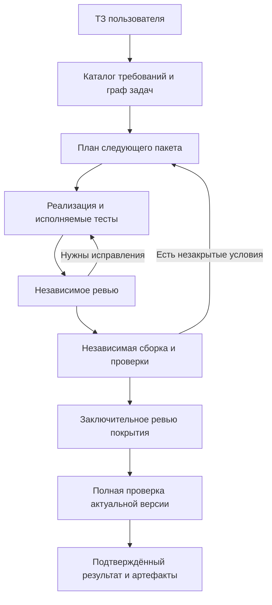

# Development Lab для создания Minecraft-модов

Описание текущего устройства лаборатории. Сверено с исходниками 12 ноября 2026.
Это описание платформы; требования конкретного мода задаются отдельным ТЗ.

## Назначение

**Codex Development Lab** — локальная система разработки с несколькими
LLM-агентами и независимым исполнителем тестов. Пользователь загружает один
Markdown-файл с ТЗ, выбирает модели и ограничения запуска. Лаборатория разбирает
требования, планирует работу, пишет исходники, проводит ревью, собирает проект
и выполняет подготовленные проверки. Ошибки и результаты возвращаются в
следующий цикл разработки.

Система работает через Docker и веб-панель. Стандартный адрес панели —
`http://127.0.0.1:8080`; порт может быть изменён настройкой установки.
Платформа допускает разные программные проекты. Для модов Minecraft в ней есть
руководство Fabric 1.21.11 и отдельная среда игровых проверок этой версии.

## Роли и ответственность

| Участник | Работа |
|---|---|
| Пользователь | Определяет результат, ограничения и доступные зависимости; отвечает на существенные вопросы по ТЗ; управляет запуском и бюджетом |
| Планировщик, LLM | Выделяет проверяемые условия ТЗ, строит граф зависимостей, выбирает следующий пакет работы и анализирует результаты прошлых попыток |
| Кодер, LLM | Исследует реальные API, реализует назначенную работу, пишет тесты и их подготовку, исправляет замечания |
| Ревьюер, LLM | Независимо читает исходники и тесты, проверяет логику и покрытие требований; исходники не меняет |
| Контроллер, программа | Проверяет форматы и зависимости, сохраняет версии, очередь этапов, память, лимиты и результаты |
| Проверяющий исполнитель, программа | В изолированной среде запускает сборку и тестовые сценарии, собирает отчёты и артефакты |

Три LLM-роли могут использовать разных провайдеров, модели и reasoning.
В текущем каталоге приложения предусмотрены Codex, DSLab, LiteLLM и MiniMax;
конкретный доступ зависит от настройки провайдера. Выбор находится в панели
**«Модели по ролям»**. Ревьюер без собственного назначения наследует модель
кодера. Это отдельный вызов с доступом только на чтение.

## Цикл разработки

Раунд — итерация работы, а не процент готовности. В памяти остаются решения,
гипотезы, замечания, изменения и результаты проверок. После паузы лаборатория
продолжает сохранённый проект; принятые контрольные точки проверяются на
актуальность перед повторным использованием.

Техническое исследование и реализация могут входить в один пакет. Недостающий
API изучается по точной версии исходников или JAR. Реальная внешняя зависимость
или неоднозначность пользовательского требования сохраняется как открытый
вопрос и ограничивает связанную работу.

## Что требуется в ТЗ мода

1. **Среда:** версия Minecraft, загрузчик, клиентский или серверный мод,
   обязательные сторонние моды и их точные версии.
2. **Результат:** что игрок получает и какое наблюдаемое событие означает успех.
3. **Управление:** клавиши, команды, настройки и публичный API, если он нужен.
4. **Поведение:** начало действия, последовательность, завершение, отмена,
   повторная попытка и реакция на смерть, выход из мира или смену измерения.
5. **Ограничения:** допустимые серверные команды, расход ресурсов, запрещённые
   действия и границы совместимости.
6. **Данные:** что сохраняется между запусками, как определяется мир и владелец.
7. **Проверки:** начальные условия, действие продукта и ожидаемый результат
   каждого существенного сценария, включая ошибки.

Для геометрии, рецептов или последовательности действий нужны точные координаты,
идентификаторы блоков, количества и правила выбора. Общая фраза «построить
подходящий дом» оставляет эти решения исполнителю.

Веб-форма принимает Markdown в UTF-8, до 1 МиБ. Соседние файлы и локальные пути
в тексте не передаются в контейнер автоматически. Если нужен предоставленный
JAR, созданное задание следует поставить на паузу, дождаться `USER_PAUSED`,
скопировать зависимость в `projects/<project_id>/workspace/libs/`, проверить её
версию и SHA-256, затем продолжить. Путь и способ подключения зависимости
нужно указать в ТЗ. Исходники другого проекта также должны быть явно переданы.

## Сборка и игровые проверки

Для Fabric 1.21.11 лаборатория содержит инженерное руководство: Java 21,
совместимые фиксированные зависимости, проверка mappings целевой версии,
обработка жизненного цикла мира и отсутствие блокирующих операций в игровом
tick. Эти правила сами по себе не добавляют моду боёвку, навигацию или интеграцию
с Саруманом.

Проверки разделяются по тому, что они подтверждают:

| Проверка | Подтверждаемый результат |
|---|---|
| Сборка Gradle | Проект компилируется; создан соответствующий JAR |
| Модульные тесты | Выполнились конкретные утверждения об изолированной логике |
| Игровые сценарии | В настоящем запущенном Minecraft наблюдалось требуемое поведение |
| Ревью покрытия | Проверки действительно выражают условия исходного ТЗ |

Штатная игровая среда использует Minecraft 1.21.11: плоский мир, survival,
normal и разрешённые команды подготовки. Шаблон создаётся настоящим сервером
без проверяемого мода; каждый отдельный прогон получает собственную копию мира
и `gameDir`. Для другой версии или особого мира нужен подходящий стенд.

Мобы, препятствия, предметы и прочие специальные условия создаёт исполняемый
код сценария. Он сначала проверяет подготовку, затем запускает действие мода
и наблюдает результат. Описание `setup` не заменяет код подготовки. Для проверки
строительства с нуля нельзя заранее создать тестом готовую постройку.

Игровой запуск требует заранее разрешённого в установке принятия Minecraft
EULA; лаборатория не принимает её за пользователя. Недоступная среда оставляет
соответствующие условия непроверенными с причиной. Отправленная команда,
принятая задача или успешная компиляция не доказывают игровой результат.

Результаты связаны с версиями ТЗ, исходников и сценариев. Для итогового
`acceptance_verified` нужны актуальное покрытие условий, заключительное ревью
и полная независимая проверка. `FINISHED / max_rounds_reached` означает
достижение лимита раундов, а не готовность мода.

## Что видно пользователю и что остаётся на диске

В панели доступны состояние и текущий этап, исходные условия и их результаты,
память агентов, история запросов, исходники и материалы проверок. Пользователь
может приостановить работу, продолжить её и изменить доступные настройки.

| Место относительно корня Lab | Содержимое |
|---|---|
| `projects/<project_id>/workspace/` | Рабочие исходники, сборка проекта и тесты |
| `artifacts/<project_id>/<job_id>/` | Отчёты раундов, журналы, результаты, снимки и выгруженные артефакты |
| Веб-панель → «Приёмка» | Связь исходных условий ТЗ с проверками и доказательствами |
| Веб-панель → «Расход» | Запросы и измеренные токены по ролям: вход, выход и кеш |

Для готового мода нужны воспроизводимые исходники, сборочные файлы и Wrapper,
production JAR, краткая инструкция и фактические результаты проверок.
Наличие файла JAR в материалах отдельно не доказывает прохождение приёмки.
Скриншоты и видео прилагаются при реальной записи; это дополнительные материалы,
они не заменяют проверки поведения. Сейчас изображения не передаются LLM-ролям
для визуального анализа.

Кеш входит в учёт входных токенов и не прибавляется к ним второй раз. Расход
токенов не равен денежному списанию или остатку подписки. Стоимость доступна
только при наличии соответствующих измерений и тарифов. Для запуска задаются
лимит раундов и ограничения API; безлимитные раунды не отменяют квоты провайдера.

## Границы автоматизации

Лаборатория автоматизирует цикл разработки, но качество результата зависит от
ТЗ, модели, тестов и доступной среды. Она не гарантирует правильность любого
мода по одному факту завершения задания. Проверять нужно конкретную сборку
и конкретные условия.

API-ключи внешних провайдеров хранятся в шлюзе. Codex использует собственную
авторизацию в своём контейнере. Личная `.minecraft` и соседние каталоги за
пределами Lab штатно не подключаются. При этом агент Codex видит проекты внутри
лаборатории; полной файловой изоляции между ними у этого агента нет. Сборочный
и тестовый запуск получает отдельную копию конкретного рабочего проекта.
Публикация, установка в основной игровой клиент и отправка изменений
в удалённый Git-репозиторий выполняются отдельно владельцем.

## Основные материалы и код

- [Обзор и запуск лаборатории](../README_RU.md).
- [Контракты агентов и постоянная память](COMPACT_AGENT_PROTOCOL_RU.md).
- [Игровая среда](TEST_WORLD_RU.md) и [исполнение сценариев](SCENARIO_EXECUTION_RU.md).
- [Бюджеты API](API_BUDGETS_RU.md).
- [Инженерное руководство Fabric 1.21.11](../skills/fabric-minecraft-12111/IMPLEMENTATION_GUIDE.md).
- [Каталог провайдеров и ролей](../common/provider_settings.py),
  [контроллер цикла](../worker/pipeline.py),
  [независимая проверка](../worker/pipeline_verification.py).
