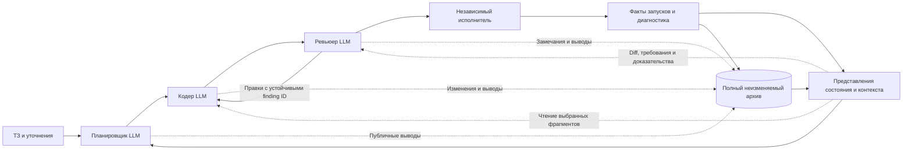

# Оптимизация планировщика, кодера и ревьюера

Дата аудита: 04.11.2026. Статус: **аудит и основания реализованного обновления**.
Работающие контракты, восстановление и порядок продолжения описаны в
[OPTIMIZED_RUNTIME_RU.md](OPTIMIZED_RUNTIME_RU.md). Ниже сохранены наблюдения
до обновления и проектные критерии. Примеры `proposal-v2` остаются поясняющими,
а действующий runtime сохраняет совместимые контракты v1.
Новых рабочих LLM-ролей, квот задач и остановок по счётчикам проект не вводит.

## 1. Вывод

Основа системы пригодна: смысловое планирование, независимое ревью, исполняемые
проверки и полный архив уже есть. Главные потери возникают между ними:

- первичная ошибка не всегда доходит до следующей роли;
- отсутствие проверки считается очередной неудачей функциональности;
- существующий код смешан со статусом его независимой проверки;
- гипотезы и замечания сохраняются, но не имеют устойчивой идентичности;
- агентам неудобно получать нужный фрагмент архива;
- сетевой сбой сохраняет файлы, но недостаточно хорошо сохраняет рабочую ориентацию;
- одинаковая suite запускается повторно для разных логических сценариев.

Приоритет — восстановить доставку фактов и причинные связи. Дополнительные
обязательные отчёты, более длинные промпты и ещё один агент этого не заменят.

## 2. Что фактически изучено

Прочитаны реализация ролей/адаптера, схемы, сборка обратной связи, история условий,
память, восстановление, проверки графа и существующие регрессионные тесты.
Дополнительно выполнен потоковый разбор **1083 архивных попыток в 7 заданиях**,
около **246,5 МБ JSONL**. Для ключевых случаев изучены сами планы, код и результаты.

- [Повторяемый скрипт измерений](../audit/analyze_pipeline_history.py).
- [Снимок измерений](../audit/pipeline-history-audit-2026-11-04.json).
- [Ранее установленные улучшения памяти](../audit/progress-recovery-v2-validation.json).
- [Установленное восстановление fixture-контрактов](../audit/fixture-contract-recovery-v1-deployment.json).

В снимке 537 попыток планировщика, 301 кодера, 172 ревьюера; у 73 старых попыток
роль не указана. Зафиксированы 285 FAIL, 3 TIMEOUT и 32 CANCELLED.
Статус PASS в истории агента означает успешное завершение его ответа, а не
готовность мода. Старые нетипизированные ошибки не классифицировались по словам.
Задания продолжают меняться, поэтому это снимок, а не транзакционная выгрузка.
Во всех заданиях найдено 514 событий отказа API-формата; это число событий,
а не 514 отдельных проваленных раундов. У Arcane в этом снимке таких событий 6,
а типизированных terminal ошибок провайдера 16. Текущий расход этого проекта
связан также с восстановлением и инструментами, а не только с форматом ответа.

У Arcane Rituals медианный начальный prompt: planner 9953 Б, coder 11693 Б,
reviewer 9372 Б. В нативных usage-событиях архива этого задания: около 6,41 млн
нового входа, 248,67 млн чтения кэша, 3,04 млн выхода. Это наблюдаемые счётчики
архивных событий; они не заменяют счёт провайдера и не включают всё живое выполнение.
Отдельно наблюдался запрос с логическим входом 292693 токена. В изученных
архивных логах Arcane событий `context.compacted` нет.

Следовательно, начальный prompt — только часть затрат. Значительны длинные
истории инструментов, повторы чтения и восстановления. Кэш уменьшает повторную
оплату согласно тарифу провайдера, но не убирает текст из внимания модели.

## 3. Подтверждённые проблемы текущего процесса

Ссылки указывают на код на дату аудита. Смысловые выводы LLM отделены от
механически наблюдаемых фактов.

| Проблема | Наблюдение | Последствие | Изменение |
|---|---|---|---|
| Ошибка общей сборки не экспортируется | [verification_feedback.py:179](../common/verification_feedback.py#L179) выбирает только проваленные сценарии; у Arcane индекс диагностики пуст | Планировщик видит отсутствие результатов вместо первичного assertion | Экспорт фактов каждого этапа, в том числе до старта сценариев |
| Короткий VerificationResult не содержит build log | [pipeline_verification.py:347](../worker/pipeline_verification.py#L347), [453](../worker/pipeline_verification.py#L453) | Полный журнал сохранён, но прямого доступного маршрута к причине нет | Устойчивый evidence handle на команду, JUnit и полный журнал |
| Общая ошибка разрастается по условиям | [pipeline_verification.py:370](../worker/pipeline_verification.py#L370), [condition_progress.py:160](../common/condition_progress.py#L160) | Не запущенная проверка увеличивает счётчик неуспешных попыток условия | `not_attempted` с `stopped_by`; отдельно считать попытки среды и продукта |
| Непроверенная зависимость считается отсутствующей | [task_graph.py:254](../common/task_graph.py#L254), [pipeline.py:450](../worker/pipeline.py#L450) | Узкий ремонт включает почти весь проект | Разделить доступность реализации и актуальность проверки |
| Смысл цели расходится с ID | В принятом плане Arcane round-04 A3 описывает C46, но выбирает C45/C47/C48 | Код есть, а правильное условие остаётся без связи с результатом | Ревьюер сверяет цель, текст условия и реальный тест; без поиска по словам |
| `read_requirements` читает старый каталог | [dslab.py:511](../agent/dslab.py#L511); все 25 изученных вызовов Arcane вернули missing_ids | Повторные поиски и риск устаревших требований | Текущий semantic catalog по умолчанию, legacy только явно |
| Память есть, но нет удобного запроса к ней | [dslab.py:189](../agent/dslab.py#L189) | Агент читает большой файловый индекс и ищет вручную | `query_memory`, `read_artifact` с фильтрами, селекторами и курсором |
| Ссылки на пропущенные оригиналы могут быть недоступны роли | [verification_feedback.py:1](../common/verification_feedback.py#L1) запрещает прямой artifact volume | «Сохранено» не означает «агент может прочитать» | Контролируемое чтение через брокер с проверкой проекта и digest |
| Вывод команды теряется при timeout | [dslab.py:1047](../agent/dslab.py#L1047): TemporaryFile, исключение до записи результата | Повторная диагностика без предыдущего вывода | Постоянные stdout/stderr и события начала/завершения, включая timeout |
| Обычный вывод команды ограничен хвостом | Там же; последние 32000 Б без полного постоянного ref | Первичная ошибка в начале остаётся за пределами ответа | Небольшая выдача плюс доступный полный оригинал |
| Ретрай роли начинает новый диалог | [pipeline.py:803](../worker/pipeline.py#L803), [dslab.py:601](../agent/dslab.py#L601) | Код сохранён, часть выводов и следующего шага восстанавливается заново | Checkpoint публичного состояния фазы и завершённых tool exchanges |
| Смешаны инструкции двух протоколов | [dslab.py:588](../agent/dslab.py#L588), [pipeline.py:1028](../worker/pipeline.py#L1028) | Противоречия про legacy, хеши, файлы и compact output | Одна активная инструкция на роль/этап |
| Формат компактный, но история гипотез неструктурирована | [agent_protocol.py:112](../common/agent_protocol.py#L112) заполняет hypotheses=[] | Переформулирование мешает распознавать повтор той же гипотезы | Устойчивые hypothesis handles + свободный Markdown |
| Сравнивается весь текст плана | [condition_progress.py:118](../common/condition_progress.py#L118) | Изменение соседней задачи меняет fingerprint гипотезы | Связь с конкретным экспериментом/условием; semantic identity оценивает LLM |
| Порядок действий выдумывается адаптером | [agent_protocol.py:114](../common/agent_protocol.py#L114) связывает каждое действие с предыдущим | Независимые действия превращаются в цепочку | Только явно указанные зависимости; соседство не означает зависимость |
| Отчёт кодера автоматически перечисляет все действия | [agent_protocol.py:145](../common/agent_protocol.py#L145) | Членство в action_ids выглядит полнее фактически выполненной работы | Короткие статусы по действиям; они остаются заявлениями кодера |
| Ревью без реального diff | [pipeline.py:1407](../worker/pipeline.py#L1407), diff_ref=None | Повторное чтение и менее точная область проверки | Diff, затронутые условия и открытые замечания |
| Замечания F1/F2 перенумеровываются | [agent_protocol.py:121](../common/agent_protocol.py#L121) | Трудно сопоставить замечание с предыдущим ответом | Постоянный finding handle и явный responds_to |
| Повторный запуск одинаковых unit-suite | [acceptance_runner.py:211](../worker/acceptance_runner.py#L211), [verification_plan.py:48](../worker/verification_plan.py#L48) | У Arcane 7 unit-сценариев вызывают один test; вместе с build возможно 8 запусков | Отделить физический ExecutionRun от логических сценариев |
| Производная сводка обрезает проверки | [failure_details.py:14](../common/failure_details.py#L14), MAX_TESTS=64 | Текущие 109 тестов не помещаются в сводку | Полные количества и страничный доступ ко всем проверкам |
| Обзор файлов смешан с архивом | [dslab.py:1004](../agent/dslab.py#L1004) | Служебные записи занимают выдачу, нет полноценного cursor | Раздельные code/memory/evidence namespaces и пагинация |
| Устаревшая документация описывает отменённые ограничения | [PLANNING_RU.md](../PLANNING_RU.md) | При чтении по ссылке могут возвращаться правила 1–4 задач/одной группы | Один текущий вход в документацию; старые версии явно помечены историческими |

Показательный эффект зависимостей: в Arcane раунде 2 первое repair-действие
содержит 18 задач для 5 условий; в раунде 3 — 18 для 5; в раунде 4 — 17 для 2.
Причина — сочетание verified-only допуска с широкими зависимостями W17/W18.
Это не требование пользователя реализовывать весь проект заново.

В раундах 2 и 3 реальный assertion один: тест ожидает рабочий каталог внутри
`/workspace/build`, а независимый раннер использует `/cache/build/test-run`.
Исправление общего тестового подхода — получать фактический Gradle layout и
сравнивать реальные пути; жёстко добавлять `/cache` в каждый проект не нужно.

## 4. Уже сделанные улучшения: сохранить

| Ранее встречавшаяся проблема | Что уже улучшено | Что нельзя вернуть |
|---|---|---|
| Успех части составного требования скрывал остальные условия | Смысловые условия и отдельные checkpoint bindings | PASS всей функции по соседнему успешному тесту |
| Новая формулировка или правка кода стирали повторный провал | История condition/scenario/checkpoint с версиями | Обнуление истории при переименовании |
| Точный текст цитаты блокировал работу | Citation advice вместо жёсткой проверки слов | Разрешение кодеру работать только после буквального совпадения цитаты |
| Невалидный JSON заставлял переписывать ответ | Compact envelopes, CAS SubmissionPatch, архив исходного ответа | Полное перепланирование для исправления типа поля |
| Ошибка внешнего файла исправлялась как поле отчёта | Fixture-contract recovery возвращает writer tools и точный файл | JSON-only repair, который не может изменить сценарий |
| Одно плохое предусловие скрывало продуктовый FAIL | Fixture assertions отдельно от product assertions | Удаление обязательного действия или эффекта ради PASS |
| Долгая подготовка/спор обрывались по часу | Soft handoff, нерешённые выводы переходят в эксперимент | Автоматический PASS или уничтожение работы при timeout |
| Сетевые ошибки и квота требовали ручного запуска | Типизированный retry, Retry-After, сохранение исходников и назначения | Поиск слов `429`/`FAIL` в произвольном tool output |
| Рост архива тормозил обработчик | Инкрементальный экспорт, отменяемая синхронизация | Перезапись всей памяти после каждого события |
| Исследование API требовало нового разрешения планировщика | Research + implementation в одной полезной работе | Обязательный новый круг лишь ради разрешения писать код |
| Медиа превращались в продуктовый блокер | Фото/видео — необязательные доказательства | Остановка реализации из-за записи экрана |
| Навигационный индекс инвалидировал принятый план | Mutable navigation исключена из смыслового binding | Сброс полезного checkpoint при добавлении записи памяти |

Источники: текущие `ask`, `citation_advice`, `provider_failures`,
`condition_progress`, `pipeline_memory`, `preparation` и соответствующие тесты;
исторические отчёты в `audit/` описывают состояние на свою дату.

## 5. Целевая схема



Архив, представления, транспорт, контроллер и исполнитель работают без LLM.
Планировщик выбирает работу и объясняет причины. Кодер реализует её и готовит
проверки. Ревьюер оценивает смысл, риски и сохранность тестов. Подтверждение
фактического исполнения принадлежит независимому процессу.

### 5.1. Полный архив отдельно от рабочего контекста

Хранить полные исходные ТЗ, сообщения, публичные заметки, ошибки, команды,
stdout/stderr, версии кода, diff, JUnit и выводы моделей. Не хранить секретные
заголовки/ключи и не публиковать скрытое внутреннее reasoning модели.

Каждый объект получает ID, scope, digest, происхождение и связи. Исходник
неизменяем; обновление создаёт новую запись. Текущие индексы пересобираются.
Отсутствие записи в короткой выдаче не означает её удаление.

Контроллер предоставляет всем выбранным провайдерам одни интерфейсы:

| Инструмент | Выдача и назначение |
|---|---|
| `read_requirement(ids)` | Текущие требования/условия, точный текст, соседние ограничения, ссылки на ТЗ и проверки; legacy namespace только явно |
| `query_memory(filters, cursor)` | Метаданные по задаче, условию, incident, hypothesis, finding, версии и producer; полный текст не загружается автоматически |
| `read_artifact(ref, selector, cursor)` | Диапазон строк, JSON pointer или страница оригинала; digest, scope, размер и продолжение |
| `read_diff(base, current, paths)` | Реальный diff кода/тестов и изменённые контракты; необходимые соседние исходники доступны отдельно |
| `record_note(kind, links, body_md)` | Сохранение публичного вывода текущей ролью; ID назначает контроллер; это не PASS |
| `read_execution(run_id, selector)` | Фактическая команда, этап, stdout/stderr, завершение и наблюдения одного запуска |

Metadata-фильтры точные. Поиск по тексту/эмбеддингам может ранжировать кандидатов,
но не устанавливает причину ошибки и не объявляет гипотезы одинаковыми.
Технические защитные пределы одной страницы/парсера явно сообщают `partial` и
cursor. Они не должны скрывать остаток архива или выдавать частичные totals за полные.

Проверка доступности ссылки входит в экспорт. Мёртвый ref возвращает явное
`unavailable` с причиной и сохраняет условие непроверенным. Роль не получает
произвольный доступ к host filesystem, Docker socket или другому проекту.

### 5.2. Состояние реализации отдельно от проверки

Для каждой задачи хранить три независимые оси:

| Ось | Примеры значений | Значение |
|---|---|---|
| Наличие реализации | `unknown`, `absent`, `present_claim`, `buildable` | Можно ли работать с существующим компонентом; claim кодера снабжён refs |
| Состояние наблюдения | `not_attempted`, `inconclusive`, `observed_fail`, `observed_pass` | Что действительно измерено, в какой версии и каким запуском |
| Актуальность проверки | `current`, `historical`, `regression_required` | Применимо ли прошлое наблюдение к текущему изменению |

`present_claim` не даёт PASS. Исторический PASS не становится текущим автоматически.
Однако изменение файла или непроверенная зависимость не означает, что её код исчез.
Ремонт существующего компонента не требует включать весь непроверенный граф.
Новая функция с действительно отсутствующей зависимостью включает её реализацию
до/вместе с зависимой работой. Реальные user/external зависимости сохраняются.

Смысл типов зависимостей определяют планировщик и ревьюер. Контроллер проверяет
ID, циклы, известные факты наличия и исполнение выбранного порядка. Он не делает
вывод о семантической готовности по названию файла.

### 5.3. Факт сбоя отдельно от гипотезы о причине

Независимый исполнитель формирует `ExecutionRun`: scope, команда, профиль,
окружение, этапы, реально выполненные тесты, завершение и полные artifact refs.
Из него контроллер выводит короткий индекс:

- наблюдаемый барьер исполнения, например конкретный JUnit assertion;
- какие действия не начинались и каким наблюдением остановлены;
- какие независимые наблюдения всё же получены;
- ссылки на исходные журналы и отчёты.

Первичный барьер означает наблюдаемый порядок исполнения, а не автоматически
установленную первопричину. Смысл причины объясняет LLM. Если процесс завершился
без достаточных данных, сохраняется `unknown`, а не причина, угаданная по словам.

Пример Arcane: `workingDirectory assertion FAIL → build FAIL → gameplay not_attempted`.
Это один incident сборки. Оно не создаёт шестьдесят опровергнутых продуктовых гипотез.
Повторение сборочного incident учитывается отдельно. Исторические записи остаются
полными, а новая производная проекция корректирует классификацию без переписи архива.

Общий `build` мог успеть исполнить настоящие продуктовые unit-тесты. Их реальные
PASS/FAIL сохраняются как наблюдения этого запуска; `not_attempted` относится
только к не начавшимся проверкам. Причина build FAIL может быть в продукте,
плохом тесте, зависимости или среде — сам факт остановки её не классифицирует.
Общая готовность при этом остаётся неподтверждённой. Изменение кода не заменяет
последний исторический FAIL на inconclusive: сохраняется FAIL с его scope,
а актуальность становится `regression_required`; новый запуск может ещё не начаться.

### 5.4. Память о гипотезах и траекториях

Использовать короткие устойчивые handles incident/hypothesis/experiment/finding.
Объяснения остаются Markdown; автоматически пересказывать их ещё одной LLM не нужно.

```text
incident I17 → наблюдение O31
hypothesis H8 → «проверка сравнивает логические и реальные пути»
experiment X12 → тот же тест в том же профиле с перенесённым buildDir
change D9 → diff проверки пути
observation O32 → конкретные свежие JUnit и stdout
assessment A5 → supported / refuted / inconclusive, объяснение и ссылки
```

LLM явно сообщает, подтверждает ли наблюдение гипотезу. Контроллер хранит автора
этой интерпретации и проверяет существование/область ссылок. Сам assertion остаётся
фактом; `supported` — оценкой модели. Неисполненный эксперимент даёт `not_tested`
или `inconclusive`, а не опровержение гипотезы.

Если идея переформулирована, агент связывает её с H8 либо объясняет новое различие.
Похожие слова не объединяются автоматически; изменение всего плана не порождает
новую гипотезу для каждого условия. Оставшаяся ошибка имеет следующий эксперимент
или условие возврата, даже когда выбрана другая независимая функциональность.

Полезная отрицательная траектория сохраняется: что пробовали, что изменили,
какой результат ожидали, что получили и что этим исключено. Успешная траектория
хранится с тем же scope и доказательствами; её нельзя переносить на другой проект
как новое обязательное требование.

## 6. Что получает и отдаёт каждая роль

Общие небольшие поля контекста создаёт контроллер. Полные документы находятся
за refs. Критический первичный факт передаётся сразу, чтобы агенту не пришлось
случайно найти причину в огромном архиве. Полный initial review ТЗ нужен при
декомпозиции; далее читаются выбранные условия и затронутые изменения.

| Роль | Сразу в контексте | По запросу | Выход |
|---|---|---|---|
| Планировщик | Текущая цель; первичный факт сбоя; состояние нужных задач; открытые H/I/F; выбранные доступные направления | Полные ТЗ, граф, диффы, история условий и экспериментов | Компактные действия, реальные зависимости, условия, регрессии, отложенная работа; объяснение Markdown |
| Кодер | Принятое назначение; конкретный дефект; затронутые условия; старые попытки по нему; открытые finding ID и ответы | Нужные исходники/API, журнал, diff, соседние ограничения | Код/тесты, пути сценариев; статус каждого назначенного действия; ссылки на заметки и нерешённое |
| Ревьюер | Принятое назначение; реальный diff; затронутые условия; новые наблюдения; прежние finding ID и ответы | Полные исходники/ТЗ и дополнительные зависимости, которые реально затронуты | Замечания с постоянными ID, область проверенного, неизвестное и рекомендованный эксперимент |

Небольшие обязательные машинные поля оставить для действий, ID, статусов,
исполняемых команд и связей. Полные рассуждения не заставлять дублировать внутри
JSON и Markdown. Хеши/scope/служебные ID вычисляет контроллер.

Вместо синтетического «все действия выполнены» кодер сообщает по каждому действию
`implemented_claim`, `partial`, `not_attempted` или `needs_experiment`, с объяснением.
Любой из этих статусов отличен от принятого результата независимой проверки.

Для нового hypothesis/finding контроллер выдаёт handle; для существующего роль
использует его handle. Это несколько машинных полей, а не новый большой контракт
для классификации каждого предложения текста. Если интерпретация ещё не сделана,
история сохраняется как `not_assessed`, без выдуманной оценки.

Ревьюер проверяет:

1. Соответствуют ли цель, выбранные ID и тест точному смыслу ТЗ.
2. Устраняет ли изменение наблюдаемую проблему или только её сообщение.
3. Сохранились ли обязательные действие и эффект, границы и негативные случаи.
4. Не выдан ли успех мока, metadata-теста или отсутствующего действия за игровой результат.
5. Какие старые замечания закрыты доказательствами, какие открыты и что проверять дальше.

Ревьюер не повторяет полный обзор проекта при каждой локальной правке. При
затронутом общем компоненте он расширяет область явно. Длительный спор переводится
в различающий эксперимент; разногласия сохраняются, счётчик не назначает PASS.

Конкретные небольшие примеры предложенных сообщений:
[optimized-examples.json](pipeline/optimized-examples.json).
Версия `proposal-v2` в них обозначает проект; текущий runtime v1 их ещё не принимает.
ID, refs, номера строк и будущие успешные наблюдения в примерах иллюстративные;
они не являются данными приёмки существующего мода.

## 7. Контекст, стоимость и восстановление

### 7.1. Контекст наращивается по необходимости

Сначала: одна актуальная инструкция роли, краткие факты и ссылки. Затем агент
читает относящиеся к задаче фрагменты. В каждый следующий запрос возвращать
дельту и актуальные ссылки, а не заново всю историю чужих ролей.

Рабочий размер контекста — мягкая настраиваемая цель с учётом реального окна
модели, резерва ответа и инструментов. Предел модели и явный бюджет пользователя
показываются отдельно. Размер страницы выдачи не становится лимитом памяти.
При неизвестном размере окна показывать неизвестное, а не угадывать возможности.

Перед сокращением истории сохранить публичное состояние: факты, опровергнутые
идеи, решения, изменённые файлы, следующий шаг и refs. Полный диалог остаётся
в архиве. Проверять не только число удалённых сообщений, но и доступность важных
отрицательных экспериментов после восстановления.

Стабильная часть инструкции идёт отдельно от изменяемого контекста. Это помогает
кэшу там, где провайдер его поддерживает. MiniMax использует собственную механику
кэша; Anthropic `cache_control` не является гарантией его работы. Показатель
`saved_input_tokens` следует назвать повторно использованным входом, а денежную
экономию считать лишь при известных тарифах свежего и кэшированного входа.

### 7.2. Сбой провайдера не перезапускает смысловую фазу

Сохранять завершённые пары tool call/result, публичный рабочий checkpoint,
pending request и идентификаторы операций. При совместимом протоколе восстановить
диалог и повторить незавершённый model request. Не выполнять команду/запись
повторно только потому, что ответ следующего model request оборвался.

Если провайдер не поддерживает перенос такого состояния, создать новый RoleContext
из актуальных фактов/заметок и ссылки на полный диалог. Честно обозначить новое
продолжение. Не обещать exactly-once для внешнего действия, исход которого неизвестен:
сначала сверить результат/процесс, затем решать повтор.

Retry остаётся типизированным: сеть/5xx/429 с backoff и Retry-After; ключ,
конфигурация и пользовательский бюджет — отдельные причины. Скрыто менять модель
нельзя. Явная пауза, отмена и изоляция остаются приоритетными.

### 7.3. Команды имеют постоянный результат

До запуска записать `command_started`; stdout/stderr дописывать в отдельные
постоянные файлы. Завершение, timeout и отмена создают terminal record и refs на
уже записанный вывод. Панель показывает, исполняется ли инструмент, ожидается ли
модель или обрабатывается результат. Короткая выдача никогда не единственная копия.

## 8. Проверять один раз, интерпретировать для нескольких сценариев

Физический `ExecutionRun` отличается от логического Scenario. Один свежий JUnit
может содержать доказательства нескольких наборов условий. Каждый набор ссылается
на тот же run ID, а не выдаёт его за несколько независимых измерений.

Объединение допустимо только при одинаковых source/spec, argv, профиле, окружении,
начальном состоянии, зависимостях, инвентаре тестов и требованиях изоляции. Если
эксперимент требует отдельного мира, чистого запуска или других прав, это другой run.
Одинаковое имя Gradle task само по себе недостаточно.

Не запускать suite автоматически и в глобальном `build`, и в каждом из семи
сценариев. Согласовать build/delivery и selected test execution без удаления
необходимых проверок. Воспроизводимость и финальная приёмка остаются обязательны.
Повторный запуск ради независимого повтора помечается как намеренный эксперимент.

## 9. Порядок внедрения

| Этап | Изменения | Как подтвердить |
|---|---|---|
| P0: доставка фактов | Build/command evidence export; сохранение timeout stdout; исправление semantic read_requirements; доступные refs | Сохранённые падения Arcane воспроизводятся без модели; следующий вход содержит точный assertion и работающую ссылку |
| P0: честное состояние | Not-attempted/stopped-by; отдельные попытки продукта и build; наличие реализации отдельно от проверки | Не начавшиеся проверки не считаются продуктовыми попытками; узкий ремонт не требует 17 соседних задач |
| P1: единый контекст | RoleContext, query/read tools, актуальные инструкции, реальные diff | Старые отрицательные выводы доступны после сокращения; каждый ref разрешается; план/ревью читают только нужные данные |
| P1: причинная история | Stable I/H/X/F, per-action outcome, связь goal↔condition на ревью | Переформулированная H8 остаётся H8; неверный ID у цели замечен; unattempted не называется refuted |
| P2: восстановление | Durable public checkpoint и tool-result recovery | Разрыв после записи файла не повторяет запись/команду без проверки и не сбрасывает назначение |
| P2: выполнение | Общий run для идентичных unit execution inputs | Семь логических сценариев дают один фактический запуск suite, все bindings и результаты сохранены |
| P3: эксплуатация | Метрики, индикаторы причины ожидания, актуальный вход в документацию | Стоимость считается на проверенный результат, агенту видны факты без чтения всего архива |

Изменения сначала проверить воспроизведением сохранённых артефактов и сценариями
сбоев. Затем сравнить старый и новый контекст на одних данных. Проверка качества
с живыми моделями — отдельный ограниченный пользователем прогон, не скрытый расход.
Обновление работающего worker применять в безопасной паузе/между заданиями.

Историю текущих проектов не сбрасывать. Новые индексы пересчитать из старых записей;
нетипизированное старое наблюдение оставить unknown. Каталог и граф переиспользовать,
исправляя только подтверждённые смысловые/структурные дефекты с историей изменения.
Миграция не выдаёт старый PASS за новую независимую проверку.

## 10. Регрессии и критерии результата

1. Компиляция/зависимости/configuration падают до JUnit: полный вывод доступен,
   продуктовые условия `not_attempted`, первичная причина не потеряна.
2. JUnit падает в общей сборке: выбран правильный testcase и полный trace, даже
   если отдельно запланированные сценарии не стартовали.
3. Три одинаковых build-падения: три попытки build-stage incident; причина
   не объявляется ошибкой среды без данных. Продуктовые эксперименты учитываются
   только при фактическом исполнении. Если build выполнил часть продуктовых
   JUnit-тестов и затем упал, их raw PASS/FAIL сохраняются; только не начавшиеся
   проверки получают `not_attempted`, общая готовность не подтверждается.
4. Непроверенная, но существующая зависимость не заставляет ремонтировать весь граф.
   Действительно отсутствующая зависимость и внешняя блокировка всё ещё учитываются.
5. 109+ проверок: полные количества, доступ ко всем страницам, отсутствие скрытого
   отбрасывания последних тестов.
6. Semantic R/C доступны через read_requirement; legacy ID не подменяет current ID.
7. Timeout команды: command/exit/полный частичный stdout доступны следующей роли.
8. Разрыв после tool write/result: восстановление не повторяет внешнее действие
   без сверки состояния; правильный source/assignment сохранён.
9. Сокращение истории: важный отрицательный эксперимент и следующий шаг остаются
   доступными по стабильным refs без перечитывания всего архива.
10. Гипотеза не измерена из-за setup/build: inconclusive; условие не закрыто.
11. Предусловие не заменяет продуктовый assertion; допустимая правка плохой
    фикстуры сохраняет обязательные действие и эффект.
12. Goal про C46 с другими ID обнаруживается содержательным ревью, без keyword gate.
13. Замечание сохраняет finding ID при переформулировании; старый ответ доступен.
14. Identical suite исполняется один раз; разные окружения/права/миры не объединяются.
15. Ссылка на другой проект, устаревший digest или выход за root отклоняются;
    отсутствие доказательств не даёт PASS и не открывает доступ к host.

Метрики сравнения: время и новые/кэшированные/выходные токены на подтверждённое
наблюдение; число повторов неизменного чтения; запросы до первого верного диагноза;
доля доступных diagnostic refs; длительность исправления формата; повторы запусков
одной suite; восстановительная работа после сетевого сбоя; доля реально проверенных
условий; сохранность нормативного смысла тестов. Показывать этапы и роли отдельно.

Целевые проценты экономии не назначаются без измерений. Ускорение, полученное
пропуском необходимых тестов или ослаблением условий, улучшением не считается.

## 11. Границы реализации в репозитории

Это изменения существующего пайплайна, а не отдельная вторая система.

| Место | Что менять |
|---|---|
| `common/pipeline_memory.py`, `memory_archive.py`, `condition_progress.py` | Переиспользовать архив, provenance, query и историю; добавить индексы incident/hypothesis/finding и различие attempted/not_attempted. Производные индексы восстанавливаются из архива |
| `common/verification_feedback.py`, `worker/pipeline_verification.py` | Общая и сценарная диагностика, stopped_by, доступные refs на stdout/JUnit; первичный факт не зависит от наличия scenario row |
| Небольшой `common/role_context.py` | Детерминированное построение контекста роли из текущих фактов, изменений и релевантных индексов. Не LLM, не пересказ ТЗ и не автоматическое установление причины |
| Небольшой `common/evidence_access.py` | Единое разрешение зарегистрированных refs, selectors, пагинации и scope. Переиспользовать безопасные anchored readers и доступные memory-query функции |
| `agent/dslab.py` и адаптер Codex | Одинаковые retrieval/note возможности, semantic read_requirement, постоянные command artifacts, сохранение и восстановление публичного состояния фазы |
| `common/task_graph.py`, `preparation.py` | Разделить зависимости наличия реализации, исполнения и проверки; убрать смешение current PASS с возможностью локального ремонта |
| `common/agent_protocol.py`, `worker/pipeline.py` | Реальные зависимости действий, per-action claims, стабильные finding/hypothesis refs, настоящий diff; checkpoint остаётся привязан к принятому назначению |
| `worker/acceptance_runner.py`, `verification_plan.py` | Согласованный execution plan и один run для одинаковых входов; проекции условий с общим provenance |
| `schemas/pipeline/` | Небольшое версионированное расширение нужных control fields; свободный Markdown сохраняется. Не добавлять обязательный JSON для каждого смыслового вывода |
| `app` и текущее описание пайплайна | Точный этап/причина ожидания, статус выполнения против проверки, затраты на полезное наблюдение; одна актуальная точка входа в документацию |

Факты, заметки и ссылки должны иметь один канонический источник. Новые представления
не дублируют полную историю и не становятся второй независимой базой истинности.
Брокер выдаёт только зарегистрированные артефакты текущего проекта и разрешённой
ревизии; полная запись из другого проекта не появляется в контексте автоматически.
