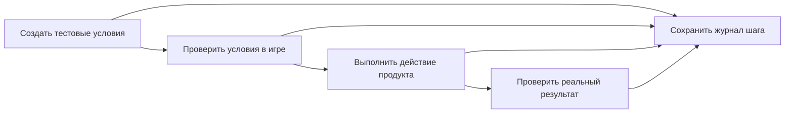

# Подготовка и выполнение игровых сценариев

Один игровой сценарий проходит четыре отдельных шага:



## Ответственность

| Уровень | Что делает |
|---|---|
| Платформа | Даёт отдельную копию базового мира, gameDir, зависимости и изолированный процесс |
| Исполняемый код теста | Создаёт нужные блоки, сущности и согласованные начальные данные проекта |
| Проверки условий | Наблюдают, что подготовка действительно завершена и видна клиенту |
| Продукт | Выполняет действие по ТЗ обычным игровым способом |
| Продуктовые проверки | Наблюдают требуемое действие и его результат |

Текст `setup` описывает условия, но не создаёт их. Кодер реализует подготовку в
тестовой обвязке. Он проверяет фактические блоки, загруженные данные и завершение
операций сервера; прошедшее время само по себе не доказывает готовность.

Пример: для проверки поведения на затопленной площадке тест создаёт площадку и
воду, затем наблюдает их на клиенте. Для проверки возобновления он создаёт
согласованные незавершённую постройку и запись реестра. Полное строительство с
пустого инвентаря начинает с пустого участка: готовый дом нельзя создавать как
его предусловие. Условия подготовки не заменяют продуктовые утверждения.

Каждый независимый сценарий получает чистое окружение. Проверка настоящего
перезапуска запускает два процесса клиента с одним сохранением внутри этого
сценария: первый сохраняет исходное состояние, второй читает его штатным путём.
Штатный адаптер задаёт одинаковые имя и offline UUID для всех клиентских
запусков внутри одной `gameDir`. Идентичность записана в
`LAB_WORLD_FIXTURE_LAUNCH`. Новая изолированная копия мира получает другую
идентичность. Это настройка тестового запуска; продукт продолжает проверять
владельца сохранённых данных.

## Результаты сохраняются по шагам

Максимальную длину записи задаёт пользователь в разделе **«Запись видео»**
через кнопку в шапке панели. Число секунд сохраняется в SQLite; по умолчанию
используется 300 секунд. Настройка действует для следующих запусков проверки.
Уже запущенный прогон использует свой сохранённый предел. Запись заканчивается
раньше максимума, если команда завершилась. Этот предел не меняет таймаут теста
и игровые задержки продукта. Хранилище загружает готовую запись целиком.

Тест обновляет JUnit после каждой выполненной проверки. Обновление атомарное:
после аварии остаётся последний целый файл с уже наблюдёнными результатами.
Неисполненные проверки сохраняют причину отсутствия результата.

Дополнительный JSONL-журнал фиксирует вход в сценарий, подготовку, начало и
завершение действий. Лаборатория передаёт путь через
`LAB_GAMEPLAY_EXECUTION_JOURNAL` и идентификатор через
`LAB_GAMEPLAY_EXECUTION_ID`. Это необязательный интерфейс тестовой программы,
а не новый формат ответа LLM.

Пример двух строк журнала:

```jsonl
{"schema_version":1,"seq":1,"scenario_id":"build-house","stage":"action","type":"started","detail":"Enable construction"}
{"schema_version":1,"seq":2,"scenario_id":"build-house","stage":"checkpoint","type":"completed","checkpoint_id":"first-block","status":"PASS","detail":"Observed the required block in the world"}
```

Тест дописывает каждую строку UTF-8 с переводом строки и сохраняет её на диск.
`seq` начинается с 1 и растёт внутри физического запуска. Если сценарий содержит
два JVM-процесса, второй продолжает последовательность в том же журнале.
Необязательный `execution_id` равен переданному `LAB_GAMEPLAY_EXECUTION_ID`.
Этапы: `setup`, `action`, `checkpoint`, `scenario`. События: `started`,
`completed`, `failed`, `crashed`. Поле `status` описывает наблюдение теста;
окончательный статус условия назначает независимая проверка JUnit.

Supervisor сохраняет журнал и отдельный `gameplay-execution.json` с результатом
физической команды. Полные журналы, начальные отчёты и снимки исходников
остаются доступны по ссылкам. Для прежних сценариев без JSONL сохраняются
наблюдения из оригинального журнала с номерами строк.

Строка в журнале об успехе служит диагностикой. PASS условия требует точного
свежего JUnit-результата и независимой проверки соответствия теста условию ТЗ.
Неуспешный выход процесса сохраняется отдельно от непроверенных условий. Так
авария после старта не превращается в вывод «ничего не запускалось».

## Разбор ошибки

Ревьюер различает наблюдение и гипотезу. Стартовый JUnit со всеми `SKIPPED`
означает отсутствие окончательных результатов. Чтобы восстановить ход прогона,
он читает журнал выполнения и исходники именно проверенной сборки.

Пример: журнал содержит начало задачи, затем аварию; JUnit остался начальным.
Подтверждены начало и авария. Следующие действия и итог продукта неизвестны.
Для причины нужны стек и код замороженной сборки. Текущая рабочая копия может
уже содержать исправление и относится к другому запуску.

При неверной подготовке зависимые условия остаются непроверенными. Реальные
продуктовые FAIL и результаты завершённых проверок сохраняются. Новая попытка
связывается с прежней ошибкой, гипотезой и проверяющим экспериментом; история
не обнуляется.

## Нерешённая работа в следующем плане

Краткая сводка содержит и проваленные проверки, и отсутствие результата из-за
неверной подготовки. Для каждого сценария и checkpoint сохраняются условия,
задачи, последний результат и ссылки на полную историю попыток.

В `selection_advice.unresolved_work_ref` находится индекс таких напоминаний.
Он показывает, какие условия выбраны, явно отложены или пока не назначены.
Планировщик выбирает полезные связанные задачи; для отложенного описывает
следующий шаг и условие возврата. Пропущенный пункт остаётся напоминанием и
не вызывает остановку, повтор планирования или расширение задания кодера.

Успех соседней проверки или смена исходников не закрывают напоминание.
Нужен результат того же checkpoint. Прежняя история остаётся доступной по
неизменяемым ссылкам после закрытия пункта. Возобновляемый кодер получает
свежую ссылку на сводку, сохраняя уже принятый план и внесённые изменения.
