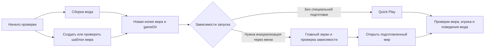

# Изолированный тестовый мир

Мир готовит программный модуль лаборатории, без LLM и без исходников проверяемого
мода. Сборка JAR и подготовка мира независимы; подготовка идёт отдельным процессом
параллельно компиляции. Сбой сборки не уничтожает уже опубликованный шаблон.



## Что создаётся

Начальный профиль: Minecraft **1.21.11**, ванильный плоский мир, survival,
normal, разрешённые команды для подготовки сценариев. Фиксированы генератор,
seed и SHA-256 официального сервера. В подготовке не участвуют моды проекта.
При другом профиле или версии нужен отдельный шаблон/исполнитель; несовместимый
мир автоматически не открывается и не обновляется.

Шаблон создаёт настоящий Minecraft Server. После окончания генерации выполняются
сохранение и штатная остановка. Только затем проверяются NBT, версия, region-файлы
и хеши, удаляются данные игрока и публикуется неизменяемый шаблон.

Каждый физический gameplay-прогон получает полную независимую копию мира и новый
`gameDir`. Конфиги аддона, старые дома, инвентарь и результаты соседнего сценария
не переносятся. Требования конкретного теста — например, запрет give или наличие
нужных мобов — готовит и проверяет сам сценарий. Базовый мир их не доказывает.

## Файлы и изоляция

| Данные | Расположение в контейнере | Доступ |
|---|---|---|
| Шаблоны | `/world-templates` | Только доверенный supervisor; root, 0700 |
| Копии и конфиги запуска | `/game-data` | Отдельный volume subpath текущего прогона |
| Отчёт генерации | `/output/world-fixture/` | Доверенные JSON и полные журналы |
| Отчёт копии | `/output/acceptance/<scenario>/world-fixture.json` | Идентификатор шаблона и отдельного запуска |
| Подготовка зависимостей | `/output/acceptance/<scenario>/client-dependency-preparation.json` | Наблюдения текущего процесса клиента; не PASS продукта |

Брокер задаёт фиксированные Docker volume subpaths. Запросы не могут выбирать
папки хоста, образы или дополнительные mounts. `.minecraft` пользователя не нужна.
Копии освобождаются после сценария; оставшиеся данные удаляются с контейнером/его
приватным каталогом брокера. Они не занимают ограниченный tmpfs `/tmp` и не попадают
обратно в исходники проекта.

Защита включает no-follow чтение, запрет hardlinks, проверку хешей, блокировку
одновременной публикации, карантин повреждённого шаблона и очистку прерванной
подготовки. Проектные процессы не видят содержимого шаблонов и не могут менять их
во время генерации. Генератор завершается при смерти подготовщика.

## Выбор режима

Для подтверждённой версии 1.21.11 обычный клиент использует Quick Play. Штатный
Fabric Client GameTest, который управляет собственным миром, распознаётся отдельно:
второе открытие мира ему не навязывается. Для своего стенда можно явно указать
в `gradle.properties`:

```properties
lab_world_fixture_mode=managed
```

`managed` и `off` сохраняют управление запуском у проекта. `quickplay` использует
шаблон лаборатории; подтверждённая поддерживаемая версия всё равно обязательна.
Тестам с собственной генерацией, измерениями или datapacks нужен собственный
профиль/managed-стенд. Изменение обычного кода мода не инвалидирует ванильный шаблон.

## Доказательства и восстановление

Подготовка зависимостей выполняется до игровых действий. Это отдельный шаг
лаборатории, который выбирается по фактическому classpath запуска и метаданным
модов. Наличие JAR среди исходных материалов само по себе ничего не включает.
Сейчас отдельный адаптер есть для UnionClef (`altoclef` 1.21.11-0.95.61): эта
версия завершает инициализацию через главный экран. Клиент проходит обычный
главный экран, проверяет настоящие цепочку задач и SlotHandler, затем открывает
копию мира. События UnionClef и приватные флаги вручную не меняются.

Проекты без этой зависимости не загружают helper и продолжают использовать
Quick Play. Требования UnionClef к ним не добавляются. Мир можно подготовить
один раз, а состояние зависимости проверяется заново в каждом процессе Java.
Готовность не определяется минутным ожиданием. Сбой оставляет точную диагностику
и непроверенные условия; настоящие продуктовые ошибки сохраняются.

`TEMPLATE_READY` означает сохранённый шаблон. `CLONE_READY` означает отдельную
копию. `LAB_WORLD_FIXTURE_LAUNCH` означает переданные аргументы запуска. Ни одно
из этих состояний не является PASS продукта или доказательством загруженного клиента.
Игровой тест должен наблюдать реальный мир, игрока, зависимости и нужное поведение.

Ошибка подготовки оставляет зависимые проверки `NOT_EXECUTED`, с точной причиной
и ссылками на оригинальные журналы. Успешные unit/build сохраняются; прежние
продуктовые FAIL не стираются. Следующий прогон может повторить подготовку.
Старый READY-отчёт, повреждённый JSON или ненулевой exit code не принимаются.
Передача больших архивов и очистка не обрываются коротким таймаутом управляющего
Unix-сокета. Медленная распаковка не означает, что проверяющий процесс запущен
или его остановка не подтверждена. Бюджеты исполнения и изоляция сохраняются.
Временные ошибки файловой системы (EINTR/EAGAIN/ESTALE/ENODATA) повторяются с
задержкой в пределах заданного времени проверки, без вызова LLM. Ошибки прав,
подмены файлов и неверной версии не обходятся. Полные трассы находятся в `error.log`.

Игровые процессы запускаются только при уже установленном
`MINECRAFT_EULA_ACCEPTED=true`. Модуль не меняет `.env` и не создаёт новое согласие.
В новом `options.txt` отключены стартовый экран доступности, обучение и пауза при
потере фокуса: они не должны оставлять headless-клиент перед меню вместо мира.

## Реализация

- `worker/world_fixture.py`: подготовка, отдельный процесс, копия и запуск.
- `worker/world_templates.py`: защищённое хранилище и проверка сохранений.
- `fixtures/minecraft-client/quickplay.init.gradle`: Quick Play или условная подготовка зависимости.
- `fixtures/minecraft-client/dependency-bootstrap/`: отдельный helper тестового клиента, не часть продукта.
- `runner/policy.py`, `runner/broker.py`: фиксированные приватные mounts.
- `worker/verification_plan.py`, `worker/acceptance_runner.py`: независимая проверка.

Серверный JAR не хранится в Git: сборка образа получает официальный файл через
`fixtures/minecraft-client/fetch_server.py` и проверяет фиксированный SHA-256.
При локальном наличии проверенного файла повторная загрузка не требуется.
